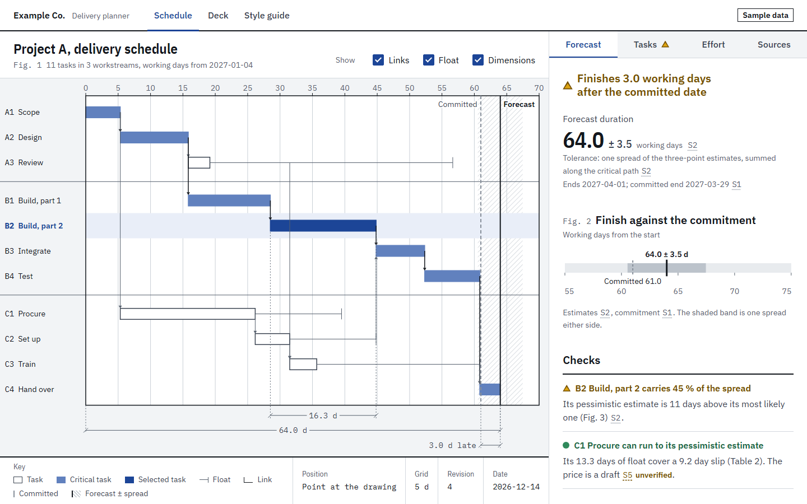
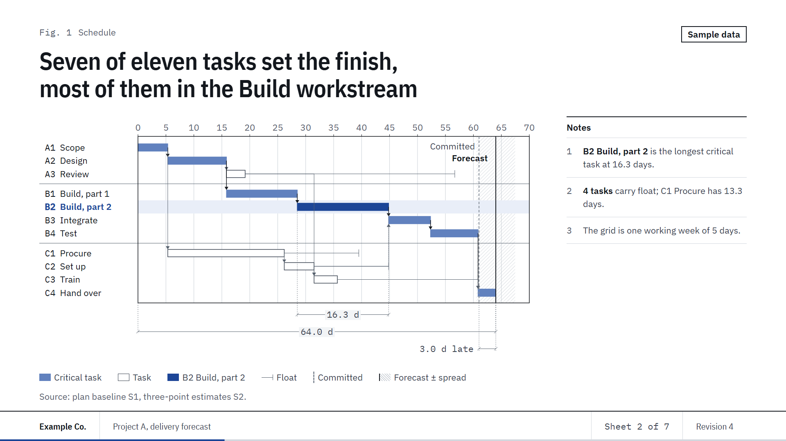
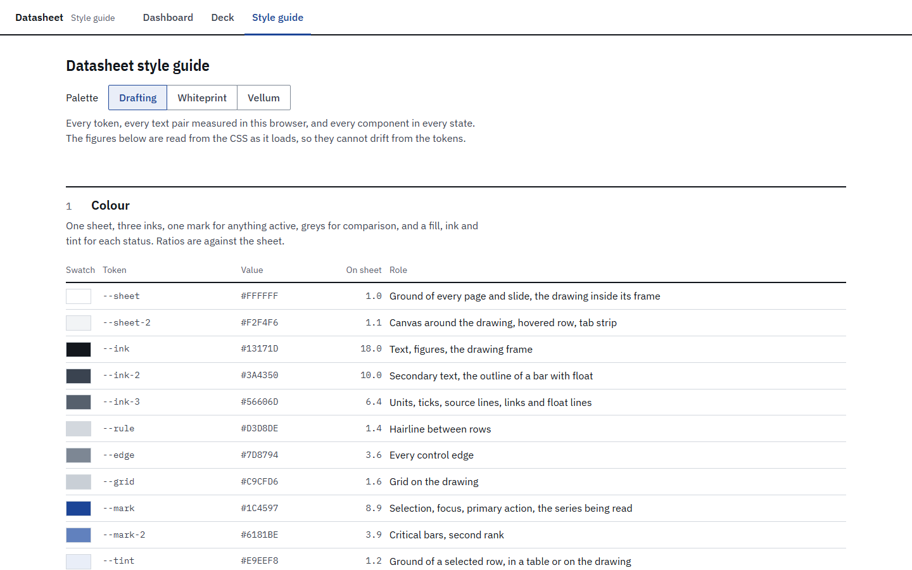

Engineering datasheet beside a drawing: white sheet, hairlines not boxes, every figure with its unit, tolerance and source.

# Datasheet template

Read [`./DESIGN.md`](./DESIGN.md) first: it holds the design rules this kit follows. This file is the API reference.

| Dashboard | Deck exhibit | Style guide |
|---|---|---|
|  |  |  |

The previews are generated by `scripts/shots.mjs` (see [Previews](#previews)); never edit them by hand.

## Layout

```
kit/tokens.css          every colour, size, space and duration, and the three palettes; the only file with hex values
kit/base.css            reset, type roles and the control family (button, input, select, segment, checkbox, field)
kit/styleguide.html     every token, palette and component in every state, measured live from tokens.css
kit/mockup/kit.css      page components (bar, canvas, drawing, title block, dock, status, source mark, tables, charts)
kit/mockup/kit.js       window.SHEET: formatting, status, source marks and card, tabs, segment, chart and timeline builders
kit/deck/sheet.css      1920x1080 slide canvas, title block, HUD and the exhibit templates
kit/deck/sheet.js       window.EX (the page builders at slide size) and the slide templates
kit/deck/deck.js        slide engine: navigation, contents, notes, presenter window, PPTX export
examples/dashboard/     a drawing and datasheet page on sample data: a project's delivery schedule (index.html + data.js)
examples/deck/          a seven-sheet review deck that reads the dashboard's data.js (index.html + slides.js)
preview/                the three README images
```

Every path inside the template is folder-relative, so the folder can be copied whole (for example as
`<project>/design/`, with the scripts at `<project>/design/scripts/`).

## Palettes

Three palettes fill the same colour roles; components never change between them.

| Palette | Attribute | Material |
|---|---|---|
| Drafting (default) | none, or `data-palette="drafting"` | Plotter ink on white bond with a solid grid: the printed datasheet |
| Whiteprint | `data-palette="whiteprint"` | A diazo print: blue-violet line work on a lilac-cast sheet, the grid a broken line |
| Vellum | `data-palette="vellum"` | Graphite on warm tracing vellum over a dotted underlay, Prussian blue as the mark |

Choose one by putting the attribute on the html element: `<html lang="en" class="sheet" data-palette="vellum">`.
The example dashboard also previews one from its URL: `examples/dashboard/index.html?palette=whiteprint`.
Pick by where the material is read: Drafting for screens and print on white paper, Whiteprint when it should sit
beside existing drawing sets, Vellum when the room is warm-lit or the material is long-form reading. Any element may
carry the attribute, which scopes that palette to it (the styleguide sets the three side by side this way). A new
palette is a new `[data-palette="name"]` block in `kit/tokens.css` that redefines the sheet, ink, mark and grey roles,
and must pass every pair in `DESIGN.md` "Contrast, measured".

## Tokens (`kit/tokens.css`)

| Role | Tokens |
|---|---|
| Sheet | `--sheet` the ground and the drawing inside its frame, `--sheet-2` the one recessed field (canvas, hovered row, tab strip) |
| Ink | `--ink` text, figures and the drawing frame, `--ink-2` secondary text, `--ink-3` units, ticks, source lines and links |
| Grid | `--grid` the drawing grid's line colour, `--grid-dash` its `stroke-dasharray` (`none`, broken or dotted per palette) |
| Rules and edges | `--rule` hairlines, `--edge` every control edge; widths `--hair`, `--rule-strong` (2 px), `--rule-sel` (3 px, the active mark) |
| Mark | `--mark` selection, focus, primary action, the measured series; `--mark-2` critical bars, second rank; `--tint` a selected row |
| Comparison and range | `--cmp`, `--cmp-fill` (comparison line, bars and the hatch of a spread); `--track` a range's axis, `--band` an estimate plus or minus its tolerance; grey, never a hue |
| Status | `--pass`, `--caution`, `--fault`, each with `-ink` (the word) and `-tint` (a ground); always with a shape and a word |
| Type | `--cond` (IBM Plex Sans Condensed: page title, headline figures, title block), `--sans` (IBM Plex Sans: running text), `--mono` (IBM Plex Mono: machine strings); `--fs-meta` (14 px, the floor), `--fs-body`, `--fs-h2`, `--fs-h1`, `--fs-fig`, `--fs-fig-lg` |
| Deck type | `--deck-cover`, `--deck-title`, `--deck-sub`, `--deck-body`, `--deck-label` (22 px, the floor), `--deck-fig`, `--deck-pad` (canvas px) |
| Space | `--s-1` .. `--s-16` on an 8 px unit; `--gap-in`, `--gap-group`, `--gap-block`; `--row`, `--ctl-h`, `--tab-h`, `--dock-w`, `--measure` |
| Shape, depth and motion | `--r-ctl` (controls only), `--lift` (popover and readout only), `--ease`, `--d-fast`, `--d-base` |

No text on a screen is smaller than 14 px; there are no cards, tiles, pills, gradients or block shadows.

## Page components (`kit/mockup/kit.css`)

Put `class="sheet"` on `<html>` and wrap the page in `.app` (bar over `main.work`).

| Class | What it is |
|---|---|
| `header.bar` > `a.brand` (`b` + `span`), `nav.modes` > `a[aria-current]`, `.bar-meta` | The bar over a 2 px rule; `.bar-meta` holds the stamp |
| `.sim` | The stamp every page on sample data carries ("Sample data") |
| `section.canvas` > `.canvas-head` (`h1`, `p.meta`, `fieldset.layers`), `.canvas-sum`, `.drawing`, `.canvas-foot` | The drawing area: head, drawing, title block; under 900 px the page moves the verdict and headline into `.canvas-sum`, above the drawing |
| `.canvas-foot` > `.tb-cell` > `.tb-cap` + `.tb-val`; `.tb-key` holds the key; `.coords` the pointer position | The drawing title block; one value per cell (revision and date are two cells) |
| `span.no` | A caption number (`Fig. 2`, `Table 1`) at the start of a heading |
| `aside.dock` > `.tabs[role=tablist]` > `button.tab[role=tab]` (`.flag` status), `.pane[role=tabpanel]` | The datasheet dock; panes are built once and toggled with `hidden` |
| `.block-head` (`h2`, `p.meta`, a control), `p.src` | A block's head and its source line |
| `.verdict`, `.headline` > `.label`, `.figline` > `.fig-lg` / `.fig`, `.tol`, `.unit` | The verdict and the headline figure with its tolerance |
| `span.status.is-pass` / `.is-caution` / `.is-fault` / `.is-none` | Status: shape plus word |
| `ul.checks` > `li` > status + `.what` | The checks list |
| `button.srcmark` (`.is-unverified`), `span.unverified`, `.pop` | Source mark and the source card it opens |
| `.tblwrap`, `table.tbl`, `td.r` (value), `td.u` (unit), `td.s` (source), `tr.total` | Spec table, units in their own column |
| `table.tbl.pick`, `button.rowbtn[aria-pressed]`, `tr.is-sel`, `tr.is-off` | A table whose rows select |
| `dl.facts` (`dt`, `dd` > `.unit`), `.actions` | Facts of the selected item; `.actions` is a row of buttons under them (the example's ±1 d stepper) |
| `ul.key` > `li` > `i.k-bar` `.k-crit` `.k-sel` `.k-float` `.k-link` `.k-target` `.k-band` `.k-col` `.k-line` | Drawn key samples |
| `.chart` (> `svg.sheet-svg` + `.readout`) | A chart box mounted by `SHEET.mount` |

Controls (`kit/base.css`): `.btn` (`.primary`, `.ghost`, `.danger`), `.input`, `.input-unit` > `.input` + `.unit`,
`.select-wrap` > `select.select`, `.seg` > `button[aria-pressed]`, `label.check` > `input` + `.box`, `.field` >
`label` + control + `.hint` / `.error`. State hooks for specimens: `.is-hover`, `.is-focus`, `.is-on`,
`.is-disabled`, `.is-error`.

## `window.SHEET` (`kit/mockup/kit.js`)

| Function | Use |
|---|---|
| `tok('--var')`, `esc(s)` | A token's value; HTML escaping |
| `fmt.num(n, dp)`, `fmt.int(n)`, `fmt.pct(n, dp)`, `fmt.signed(n, dp)` | en-US numbers; `pct` writes `82 %`, `signed` a true minus |
| `nice(max)` | `{top, step}` for a clean axis |
| `status(kind, word?)` | Status HTML; `kind` is `pass`, `caution`, `fault` or `none` |
| `srcmark(id, registry)` | A source mark; an entry with `verified: false` adds the word "unverified" |
| `sources(registry)` | Wires every `[data-src]` on the page to one source card (title, source, method, formula, date, gap). Escape or a click outside closes it and returns focus |
| `tabs(tablist, {onChange})` | Roving tabindex, arrows, Home and End, a URL hash per tab, hidden panes |
| `seg(group, onChange(value))` | One pressed button at a time |
| `columns(opt)` | `{width, height, fs, rows:[{label, v}], ref:[v], refLabel, unit, extreme:'min'\|'max', fmt, aria}`: zero-based columns, a dashed reference, the extreme labelled |
| `range(opt)` | `{width, fs, min, max, value, tol, target, targetLabel, unit, fmt, aria, markLabel}`: one estimate with its tolerance band against a dashed target, on a stated axis |
| `ranked(opt)` | `{width, fs, rows:[{label, v}], unit, fmt, aria, sort}`: sorted bars on one scale; never stacked |
| `mount(host, build(width), {readout(i)})` | Draws `build` at the host's width, redraws on resize; pointer, focus, arrows, Home, End, Escape and touch drive the readout. Returns `{redraw}` |
| `timelineSVG(model, opt)` | `{width, height, fs, sel, layers:{links, float, dims}, id, focusable, label(row), aria}`: the drawing as static SVG, returns `{svg, geo}` (`geo.at(x, y)` gives `{t, row}`); every layer defaults to on |
| `timeline(host, model, opt)` | The live drawing: `{sel, layers, aria, label(row), onSelect(id), onPointer({t, row} \| null)}`; rows are buttons (click, Enter, Space). Returns `{select(id), layers(patch), redraw(model?)}` |

A drawing model is `{grid, unit, end?, rows:[{id, label, group, start, end, float?, critical?}],
links?:[[fromId, toId, strong?]], marks?:[{at, label, kind:'target'|'forecast'}], band?:[from, to],
dims?:[[from, to, text]]}`, with times in one unit counted from 0. Rows are drawn in order; a rule separates groups.
`examples/dashboard/data.js` holds the inputs of one project and derives every figure, the model included, in
`PROJECT.derive()`.

`examples/dashboard/index.html` wires all of these together; start a new page by copying it.

## Decks

A deck page loads, in this order: `kit/mockup/kit.js`, your data, `kit/deck/sheet.js`, `slides.js` (yours),
`kit/deck/deck.js`, plus the HUD markup from `examples/deck/index.html`.

```js
window.DECK_CONFIG = { file: 'project-a-forecast', org: 'Example Co.', title: 'Project A, delivery forecast', rev: 'Revision 4', stamp: 'Sample data' };
window.DECK_SLIDES = [ { type: 'cover', ... }, ... ];
```

| `DECK_CONFIG` key | Meaning |
|---|---|
| `file` | PPTX file name (the date is appended) |
| `org`, `title`, `rev` | The title block on every slide: organisation, deck title, revision; `Sheet n of N` is added |
| `stamp` | A corner stamp on every slide (`Sample data` on sample material) |

### Slide types

| `type` | Fields |
|---|---|
| `cover` | `kicker`, `title` (the finding with its condition), `sub`, `spec:[[characteristic, value, unit, basis]]` (a spec table, three rows at most) |
| `exhibit` | `no`, `kicker`, `title` (the finding), `sub?`, `figure` (SVG from `EX`), `key:[[class, label]]`, `sheetNotes:[html]`, `source` |
| `table` | `no`, `kicker`, `title`, `columns:[{label, r?}]`, `rows:[{cells, total?, sel?}]`, `sheetNotes`, `source` |
| `figure` | `no`, `kicker`, `title`, `value`, `unit`, `sub?`, `figure?` (an exhibit under the number), `source` |
| `close` | `kicker`, `title`, `asks:[[ask, detail]]` |

Every slide may carry `notes` (speaker notes, also written into the PPTX). `no` is the page's caption number for the
same figure. An unknown `type` throws, naming the slide.

### `EX` builders (inside `figure`)

`EX.columns(opt, notes = true)`, `EX.ranked(opt, notes)`, `EX.range(opt, notes)` and `EX.timeline(model, opt, notes)` call
the `SHEET` builders with the exhibit box of a slide (1728 px wide, or 1224 beside the notes column) and slide type
(22 px). `EX.size(notes, height)` returns that box.

### Keys and export

`←` `→` `Space` move, `Home`/`End` jump, `D` contents, `N` notes, `P` presenter window, `F` full screen, `E` export
PPTX. `#n` in the URL opens slide n. The export renders each slide with html2canvas into PptxGenJS, one image per slide
plus its notes; it needs the page served over http.

## Install notes

- **Fonts**: Google Fonts, `IBM Plex Sans` (400, 500, 600), `IBM Plex Sans Condensed` (400, 500, 600) and `IBM Plex
  Mono` (400, 500); `kit/base.css` imports
  `https://fonts.googleapis.com/css2?family=IBM+Plex+Mono:wght@400;500&family=IBM+Plex+Sans+Condensed:wght@400;500;600&family=IBM+Plex+Sans:wght@400;500;600&display=swap`.
- **Serve over http**, e.g. `python -m http.server 8791` from the repository root. Pages open from `file://`, but the
  PPTX export does not work there.
- **CDN libraries the kit loads** (pinned; nothing else, no chart library): `html2canvas@1.4.1` and
  `pptxgenjs@3.12.0` from cdn.jsdelivr.net, by the deck page, for the export.
- **The drawing needs no external service**: it is inline SVG drawn from `data.js`.
- **Scripts** (`scripts/click.mjs`, `scripts/shots.mjs`) need Node and any Playwright install with Chromium. Set
  `PLAYWRIGHT_PATH` to a folder (or its `package.json`) whose `node_modules` holds `playwright`; without it the
  scripts resolve `playwright` from their own folder upwards.

## Checks

```bash
# every control on each page: 0 console errors, 0 controls that do nothing, every link answers 200
node scripts/click.mjs http://127.0.0.1:8791/templates/datasheet/examples/dashboard/ \
  "http://127.0.0.1:8791/templates/datasheet/examples/deck/#2" http://127.0.0.1:8791/templates/datasheet/kit/styleguide.html
# screenshots at 1366x768, 1920x1080, 2560x1440 and 390x844 into .shots/
node scripts/shots.mjs http://127.0.0.1:8791/templates/datasheet/examples/dashboard/
# no hex outside the tokens file: prints nothing
grep -rnE "#[0-9A-Fa-f]{6}\b" templates/datasheet --include=*.css --include=*.js --include=*.html | grep -v kit/tokens.css
```

The styleguide's contrast table re-measures every pair in the browser for the palette its switch selects; section 2
measures the three palettes side by side.

## Previews

```bash
node scripts/shots.mjs --out templates/datasheet/preview --size 1440x900 --name dashboard http://127.0.0.1:8791/templates/datasheet/examples/dashboard/
node scripts/shots.mjs --out templates/datasheet/preview --size 1920x1144 --el "#deck-frame" --name deck "http://127.0.0.1:8791/templates/datasheet/examples/deck/#2"
node scripts/shots.mjs --out templates/datasheet/preview --size 1440x900 --name styleguide http://127.0.0.1:8791/templates/datasheet/kit/styleguide.html
```

The deck viewport is 64 px taller than the canvas so the slide renders at 1:1 above the control strip. The previews use
the default palette.
