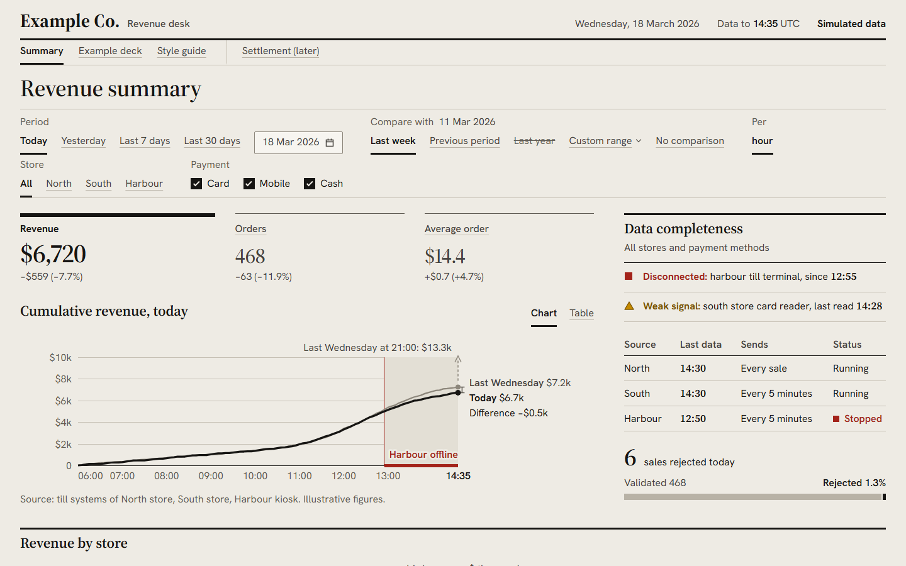
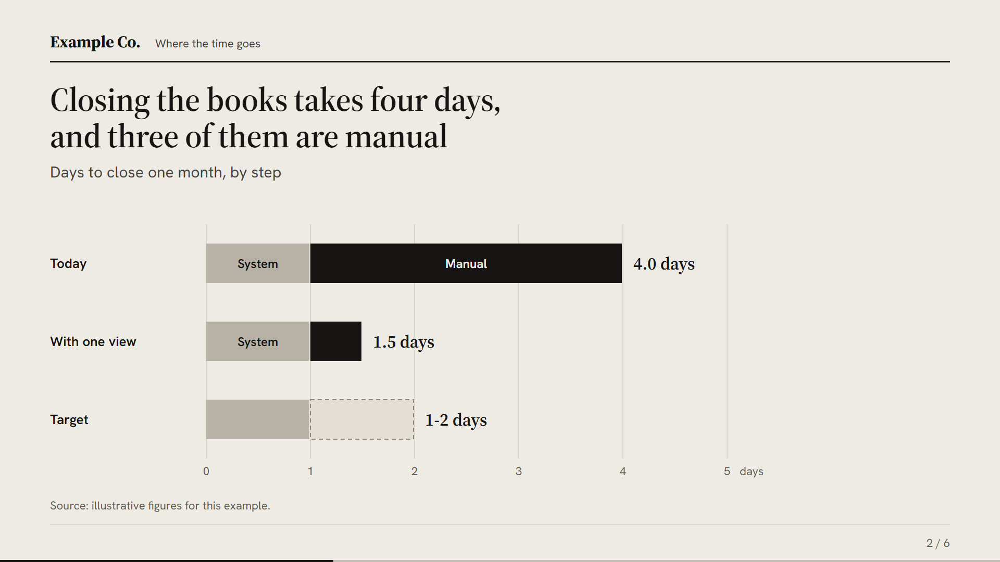
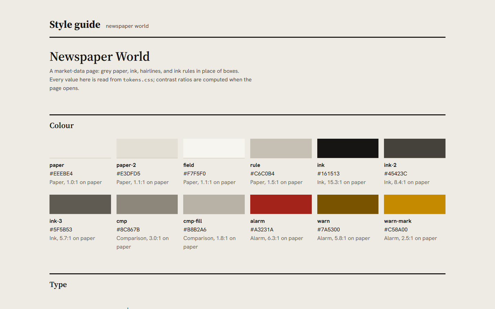

Newspaper markets-data page: paper and ink, rules not boxes, colour only for alarms.

# Newspaper template

Read [`./DESIGN.md`](./DESIGN.md) first: it holds the design rules this kit follows. This file is the API reference.

| Dashboard | Deck exhibit | Style guide |
|---|---|---|
|  |  |  |

The previews are generated by `scripts/shots.mjs` (see [Previews](#previews)); never edit them by hand.

## Layout

```
kit/tokens.css          every colour, size, space and duration; the only file with hex values
kit/base.css            reset and body type, shared by pages and decks
kit/styleguide.html     every token and component, rendered live from tokens.css
kit/mockup/kit.css      page components (masthead, text tabs, metric tabs, chart, tables, alarms, calendar)
kit/mockup/kit.js       window.KIT: chart, alarm lines, range and proportion bars, period state and its controls
kit/deck/chartbook.css  1920x1080 slide canvas, HUD and the exhibit templates
kit/deck/chartbook.js   window.CB builders and the chartbook slide templates
kit/deck/deck.js        slide engine: navigation, contents, notes, presenter window, PPTX export
examples/dashboard/     one summary page on generated data (index.html + data.js)
examples/deck/          a six-slide deck (index.html + slides.js)
preview/                the three README images
```

Every path inside the template is folder-relative, so the folder can be copied whole (for example as
`<project>/design/`, with the scripts at `<project>/design/scripts/`).

## Tokens (`kit/tokens.css`)

| Role | Tokens |
|---|---|
| Ground | `--paper` page, `--paper-2` a quiet band (the chart's outage band), `--field` an input |
| Ink | `--ink` text and the actual series, `--ink-2` secondary text, `--ink-3` labels and axis text |
| Rules | `--rule` hairlines; widths `--hair`, `--rule-head` (3 px heads), `--rule-sel` (selected tab) |
| Comparison | `--cmp` comparison line, `--cmp-fill` comparison bars; grey, never a hue |
| Alarm | `--alarm` (high), `--warn` text and `--warn-mark` shape (medium); always with a word and a shape |
| Type | `--serif` (Source Serif 4), `--sans` (Hanken Grotesk); `--fs-body`, `--fs-lead`, `--fs-h2`, `--fs-flag`, `--fs-h1`, `--fs-fig-sm`, `--fs-fig`, `--lh-fig` |
| Deck type | `--deck-title`, `--deck-sub`, `--deck-body`, `--deck-label`, `--deck-fig`, `--deck-pad` (canvas px) |
| Space | `--s-1` .. `--s-8`; `--gap-sub`, `--gap-head`, `--gap-block`, `--gap-page`, `--row-pad`, `--row-h` |
| Shape and motion | `--r-ctl` (control radius), `--ease`, `--d-fast`, `--d-base` (state changes only; no fade-in, no count-up) |

No text on a screen is smaller than 16 px; there are no cards, tiles, pills, shadows or gradients.

## Page components (`kit/mockup/kit.css`)

Put `class="news"` on `<html>` and wrap the page in `.page`.

| Class | What it is |
|---|---|
| `header.mast` > `a.brand` (`b` + `span`), `p.meta` | Flag and section name over a 3 px rule; the meta line holds the date, the data cut and the stamp |
| `.sim` | The stamp every page on generated data carries ("Simulated data") |
| `nav.sections` > `a[aria-current]`, `a.later` | Section line under the masthead |
| `section.title h1` | Page title |
| `form.controls` > `fieldset` > `legend` + `.opts` | Control row; `label.pick` (radio drawn as a text tab), `label.tick` (checkbox), `span.guard` (why a click was refused) |
| `.metrics[role=tablist]` > `button.metric[role=tab]` > `.lbl .val .chg` | Headline figures that are also the chart's tabs |
| `.head` > `h2` + `p.sub.legend` + `.switch` (buttons with `aria-pressed`) | Block head with its Chart / Table switch |
| `.plot` (> `svg` + `.readout`) | Chart box drawn by `KIT.plot` |
| `.tblwrap`, `table.table`, `.table.stack`, `tr.total`, `th.r`/`td.r` | Ruled tables; `.stack` folds rows into blocks on phones |
| `h2.ruled` | Heading over a heavy rule (side column, sections) |
| `ol.alarms` | Alarm lines from `KIT.alarms` |
| `.state.bad`, `.state.warn` | Status word with its shape |
| `.src` | One source line under a figure |
| `.key`, `.k-cmp`, `.k-cur`, `.k-run`, `.key.ln` | Drawn legend keys |

## `window.KIT` (`kit/mockup/kit.js`)

| Function | Use |
|---|---|
| `DAY`, `p2(n)`, `num(n)`, `tok('--var')` | Constants and formatting (en-US numbers); `tok` reads a token's value |
| `MON`, `MONTH`, `WEEKDAY` | English month and weekday names |
| `dstart(key)`, `addDays(key, n)`, `keyOf(ts)`, `dmy(key)`, `dmyy(key)`, `rangeTxt(a, b)` | Day keys `'YYYY-MM-DD'` in UTC |
| `nice(max)` | `{top, step}` for a clean axis |
| `plot(box, {readout(i, C), label(C)})` | SVG chart; returns `{draw(model), hide()}`. Model: `{kind:'line', mode, pts:[{t,cur,cmp}], x0, x1, xTicks, xTick, now, yTick, end, ends:{cur,cmp,fmt,diff}, close:{v,text,rise}, bands:[{from,to,text}]}` or `{kind:'bar', pts:[{t,cur,cmp,partial}], xLabel, xSub, yTick, end}`. Arrow keys move the readout |
| `alarms(items)` | `<li>` lines from `[{level:'hi'\|'mid', state, what, pre, at}]`, in priority order |
| `rangeBar({lo, hi, x}, fmt, sr)`, `rangeKey(lo, hi, mark)` | Where today sits among recent days, and its column key |
| `prop(rest, part, sr)` | Proportion bar; `rest`/`part` are `{label, n, v?}` |
| `tablist(el, pick)` | Arrow-key navigation over `[role=tab]` |
| `keepOne(form, name, guard, msg)` | Refuses unticking the last checkbox of a group and says why |
| `period({today, cut, start})` | Period state `P`: `read`, `fix`, `params`, `win`, `cmp`, `pers`, `defPer`, `names`. State `S = {p, per, vs, vc}`; `p` is `today`, `yesterday`, `7-days`, `30-days`, a day or `a..b`; `vs` is `week`, `previous`, `year`, `custom`, `none`; `per` is `hour` or `day` |
| `periodUI(form, P, set)` | Builds the period, comparison and step controls plus the calendar popover in `form`; returns `{sync(S)}` and calls `set(patch)` on every choice. Below 600 px it folds the row into one summary button |

`examples/dashboard/index.html` wires all of these together; start a new page by copying it.

## Decks

A deck page loads, in this order: `slides.js` (yours), `kit/deck/chartbook.js`, `kit/deck/deck.js`, plus the HUD markup
from `examples/deck/index.html`.

```js
window.DECK_CONFIG = { file: 'example-deck', flag: 'Example Co.', dark: ['statement'], footer: '', stamp: '' };
window.DECK_SLIDES = [ { type: 'cover', ... }, ... ];
```

| `DECK_CONFIG` key | Meaning |
|---|---|
| `file` | PPTX file name (the date is appended) |
| `flag` | The flag printed on the cover and over every exhibit |
| `dark` | Slide types drawn on the ink ground |
| `footer` | Left footer text on exhibits (e.g. a handling marking) |
| `stamp` | A corner stamp on every slide |

### Slide types

| `type` | Fields |
|---|---|
| `cover` | `lead`, `title`, `meta`, `logo?`, `logoAlt?`, `sender?`, `senderAlt?` |
| `divider` | `part`, `title` |
| `exhibit` | `kicker`, `title` (states the finding), `sub?`, `figure` (HTML or `(CB) => html`), `source` |
| `statement` | `title` |
| `close` | `kicker`, `title`, `sub?`, `asks[]`, `contact`, `senderLogo?`, `senderAlt?` |

Every slide may carry `notes` (speaker notes, also written into the PPTX) and `dark: true|false`. A `kicker` starting
with `Appendix` groups the slide under Appendix in the contents. `deck.js` also keeps older base templates
(`section`, `ledger`, `rows`, `table`, `picture`, `timetable`, `html`); the chartbook types above replace `cover`,
`statement` and `close`.

### `CB` builders (inside `figure`)

| Builder | Arguments |
|---|---|
| `CB.bars` | `{rows:[{label, end, parts:[{v, kind:'base'\|'add'\|'range', label?}]}], max, ticks, unit, aria}` |
| `CB.table` | `{columns:[label \| {label, r?, w?}], rows:[[cells] \| {total:true, cells}], dense?}` |
| `CB.mark(kind, text)` | Row mark: `''` filled, `'later'` ring, `'no'` alarm ring, `'none'` blank |
| `CB.ledger` | `[[markKind, label, text]]` |
| `CB.key` | `[[kind, label]]`, kind `cur`, `cmp`, `later`, `dot`, `ring`, `x` |
| `CB.flow` | `{sources:[{label, now}], outputs:[{label, now}], centre, via?, steps?, aria}` |
| `CB.gantt` | `{months:[...], rows:[{what, from, to}], milestones:[{at, label}], aria}` |
| `CB.breakpoint` | `{min, rate, maxSales, maxY, labels, aria}` |
| `CB.silos` | `{sources, target, manual, aria}` |
| `CB.latency` | `{before, after, axis, aria}` |
| `CB.exchange` | `{a, b, there, back, aria}` |
| `CB.fan` | `{years, aria}` |
| `CB.desktop(m)`, `CB.phone(m)`, `CB.callouts({shot, w, pins, gut})` | A live page in a frame (`m = {src, shot, label}`); `shot` is the still the PPTX export uses |

### Keys and export

`←` `→` `Space` move, `Home`/`End` jump, `D` contents, `N` notes, `P` presenter window, `F` full screen, `E` export
PPTX. `#n` in the URL opens slide n. The export renders each slide with html2canvas into PptxGenJS, one image per slide
plus its notes; it needs the page served over http.

## Install notes

- **Fonts**: Google Fonts, `Source Serif 4` (with the `opsz` axis) and `Hanken Grotesk`; every page links
  `https://fonts.googleapis.com/css2?family=Hanken+Grotesk:wght@400..800&family=Source+Serif+4:opsz,wght@8..60,400..700&display=swap`.
- **Serve over http**, e.g. `python -m http.server 8791` from the repository root. Pages open from `file://`, but the
  PPTX export does not work there.
- **CDN libraries the kit loads** (pinned; nothing else, no Chart.js):
  - `html2canvas@1.4.1` and `pptxgenjs@3.12.0` from cdn.jsdelivr.net, by the deck page, for the export
  - `cally@0.9.2` from cdn.jsdelivr.net, loaded by `KIT.periodUI` when the calendar first opens
- **Scripts** (`scripts/click.mjs`, `scripts/shots.mjs`) need Node and any Playwright install with Chromium. Set
  `PLAYWRIGHT_PATH` to a folder (or its `package.json`) whose `node_modules` holds `playwright`; without it the
  scripts resolve `playwright` from their own folder upwards.

## Checks

```bash
# every control on each page: 0 console errors, 0 controls that do nothing, every link answers 200
node scripts/click.mjs http://127.0.0.1:8791/templates/newspaper/examples/dashboard/ \
  "http://127.0.0.1:8791/templates/newspaper/examples/deck/#2" http://127.0.0.1:8791/templates/newspaper/kit/styleguide.html
# screenshots at 1366x768, 1920x1080, 2560x1440 and 390x844 into .shots/
node scripts/shots.mjs http://127.0.0.1:8791/templates/newspaper/examples/dashboard/
```

## Previews

```bash
node scripts/shots.mjs --out templates/newspaper/preview --size 1440x900 --name dashboard http://127.0.0.1:8791/templates/newspaper/examples/dashboard/
node scripts/shots.mjs --out templates/newspaper/preview --size 1920x1144 --el "#deck-frame" --name deck "http://127.0.0.1:8791/templates/newspaper/examples/deck/#2"
node scripts/shots.mjs --out templates/newspaper/preview --size 1440x900 --name styleguide http://127.0.0.1:8791/templates/newspaper/kit/styleguide.html
```

The deck viewport is 64 px taller than the canvas so the slide renders at 1:1 above the control strip.
